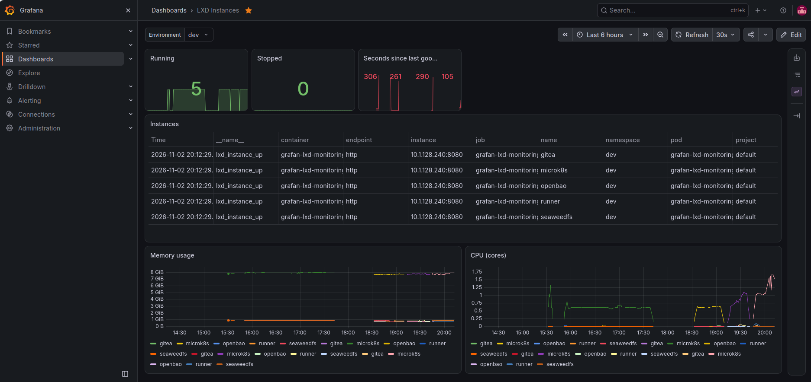

# Grafan lxd monitoring webui



## grafan-lxd-monitoring

A lightweight Go exporter that exposes the live state of LXD instances (VMs and containers) as Prometheus metrics, with a ServiceMonitor and a Grafana dashboard shipped in the Helm chart.

There is no web UI. The app serves `/metrics` and `/healthz` only.

Deployed on MicroK8s via Helm across three isolated environments, **dev**, **staging** and **live**, using a Gitea Actions CI/CD pipeline with sequential environment promotion. Helm release name: `grafan-lxd-monitoring`.

---

## Table of Contents

* [Summary](#summary)
* [Folder Structure](#folder-structure)
* [Architecture](#architecture)
* [Prerequisites](#prerequisites)
* [Quick Steps to Deploy](#quick-steps-to-deploy)
* [Verify](#verify)
* [Workflow Details](#workflow-details)
* [Go App Details](#go-app-details)
* [Metrics Reference](#metrics-reference)
* [Helm Chart](#helm-chart)
* [Roadmap](#roadmap)

---

## Summary

The exporter authenticates to OpenBao via AppRole, reads the LXD TLS client certificate and key from `homelab/data/lxd`, and polls the LXD API in the background (default every 30 seconds). Results are cached in memory and served on `/metrics`, so a Prometheus scrape never triggers a Vault login or an LXD call.

The Helm chart ships:

* a **ServiceMonitor** so the Prometheus Operator (kube-prometheus-stack) discovers the app
* a **Grafana dashboard ConfigMap** (label `grafana_dashboard: "1"`) that the Grafana sidecar imports automatically

---

## Folder Structure

```
.
├── app/
│   ├── main.go               # HTTP server (/metrics, /healthz), LXD + OpenBao client logic
│   ├── metrics.go            # Prometheus collector, background LXD poller
│   ├── dockerfile            # Multi-stage Docker build
│   ├── go.mod
│   └── go.sum
├── helm-chart/
│   ├── Chart.yaml
│   ├── values.yaml           # Base defaults
│   ├── values-dev.yaml       # dev overrides
│   ├── values-staging.yaml   # staging overrides
│   ├── values-live.yaml      # live overrides
│   ├── dashboards/
│   │   └── lxd-dashboard.json
│   └── templates/
│       ├── deployment.yaml
│       ├── service.yaml
│       ├── servicemonitor.yaml
│       └── grafana-dashboard.yaml
├── .gitea/
│   └── workflows/
│       ├── pr-pipeline.yml   # PR flow: build -> dev -> staging
│       ├── push-pipeline.yml # Merge flow: build -> live
│       └── destroy.yaml      # Manual uninstall per environment
├── Makefile                  # docker-based go init/tidy/fmt/check
├── .gitignore
├── CLAUDE.md
└── README.md
```

---

## Architecture

```
                 ┌──────────────────────────────────────────────┐
                 │        grafan-lxd-monitoring pod             │
                 │                                              │
                 │  background poller (every POLL_INTERVAL)     │
                 │    1. AppRole login to OpenBao               │
                 │    2. read homelab/data/lxd (cert + key)     │
                 │    3. GetInstancesFull() from LXD API        │
                 │    4. cache result in memory                 │
                 │                                              │
                 │  :8080/metrics  <- serves cached values      │
                 │  :8080/healthz  <- readiness / liveness      │
                 └──────────────┬───────────────────────────────┘
                                │ scrape every 30s
                                ▼
                 ┌──────────────────────────────┐
                 │ Prometheus (kube-prometheus- │
                 │ stack, monitoring namespace) │
                 │  picks up the ServiceMonitor │
                 └──────────────┬───────────────┘
                                │ query
                                ▼
                 ┌──────────────────────────────┐
                 │ Grafana                      │
                 │  sidecar imports ConfigMap   │
                 │  "LXD Instances" dashboard   │
                 └──────────────────────────────┘
```

### Secrets architecture

```
K8s Secret (openbao-creds)          <- created manually via kubectl
├── VAULT_ADDR                         in each namespace (dev/staging/live)
├── VAULT_ROLE_ID
└── VAULT_SECRET_ID
         │
         │  envFrom in deployment.yaml
         ▼
      Go app (poller)
         │  AppRole login (once per poll)
         ▼
      OpenBao
         └── homelab/data/lxd
                  ├── client_cert  -> LXD TLS auth
                  └── client_key   -> LXD TLS auth
                           │
                           ▼
                        LXD API
```

### CI/CD secrets architecture

```
Gitea org secrets (VAULT_ADDR, VAULT_ROLE_ID, VAULT_SECRET_ID)
        │  AppRole login
        ▼
OpenBao -> homelab/data/microk8s (kubeconfig)
        │
        ▼
Gitea runner (LXD VM): export KUBECONFIG=/tmp/kubeconfig
        │
        ├─> helm deploy dev
        ├─> helm deploy staging
        └─> helm deploy live

PR Pipeline:   build-pr -> deploy-dev-pr -> deploy-staging-pr
Push Pipeline: build    -> deploy-live
```

---

## Prerequisites

| Tool | Purpose |
|---|---|
| Docker | Build and push the image |
| MicroK8s | Kubernetes cluster |
| Helm | Deploy the application |
| OpenBao | Secrets backend (AppRole auth) |
| LXD | Target API to query |
| Gitea + runner | Source control and CI/CD |
| kube-prometheus-stack | Prometheus Operator, Prometheus, Grafana (separate `monitoring` repo) |

MicroK8s add-ons required:

```bash
microk8s enable dns registry helm3
```

kube-prometheus-stack must already be running and configured so that:

* `prometheus.prometheusSpec.serviceMonitorSelector: {}` and `serviceMonitorNamespaceSelector: {}` (picks up ServiceMonitors from every namespace)
* `grafana.sidecar.dashboards.enabled: true` with `searchNamespace: ALL` and label `grafana_dashboard` (imports the dashboard ConfigMap from every namespace)

### One-time infrastructure setup

**MicroK8s**: create namespaces and inject OpenBao credentials as K8s secrets:

```bash
microk8s kubectl create namespace dev
microk8s kubectl create namespace staging
microk8s kubectl create namespace live

for NS in dev staging live; do
  microk8s kubectl create secret generic openbao-creds \
    --from-literal=VAULT_ADDR=https://<openbao-ip>:8200 \
    --from-literal=VAULT_ROLE_ID=<role-id> \
    --from-literal=VAULT_SECRET_ID=<secret-id> \
    --namespace=$NS \
    --dry-run=client -o yaml | microk8s kubectl apply -f -
done
```

**OpenBao**: the LXD client cert and key must exist at `homelab/data/lxd` with keys `client_cert` and `client_key`, and the `gitea-runner` policy must allow `read` on it (plus `homelab/data/microk8s` for the pipelines).

**Gitea org secrets**: add at org level so all repos can use them:

```
Settings -> Secrets -> VAULT_ADDR
                    -> VAULT_ROLE_ID
                    -> VAULT_SECRET_ID
```

---

## Quick Steps to Deploy

### 1. Clone and create a branch

```bash
git clone https://gitea.local/jeffreyalie/grafan-lxd-monitoring.git
cd grafan-lxd-monitoring
git checkout -b feature/my-change
```

### 2. Make changes and check locally
If main.go is modified then use **Makefiel**

The `Makefile` runs Go inside Docker instead of requiring a local toolchain:

```bash
make init       # first time only
make tidy       # if modules changed
make check      # gofmt, go vet, go build
```

### 3. Push and raise a PR

```bash
git add .
git commit -m "feat: my change"
git push origin feature/my-change
```

Open a PR in Gitea: `feature/my-change -> main`. This triggers **pr-pipeline.yml**: build, deploy to dev, deploy to staging.

### 4. Merge to main

Once the PR is merged, **push-pipeline.yml** builds and deploys to live.

> Both pipelines currently use `workflow_dispatch`. Switch them to `pull_request` / `push` triggers once validated (see [Roadmap](#roadmap)).

---

## Verify

```bash
# Pod and release
microk8s kubectl get pods -n dev -l app=grafan-lxd-monitoring
helm list -n dev

# Metrics endpoint
microk8s kubectl port-forward -n dev svc/grafan-lxd-monitoring 8080:80
curl -s localhost:8080/metrics | grep ^lxd_
curl -s localhost:8080/healthz

# ServiceMonitor and dashboard objects
microk8s kubectl get servicemonitor -n dev
microk8s kubectl get configmap -n dev -l grafana_dashboard=1
```

Then check that the target is **UP** in Prometheus (`Status -> Targets`, look for `serviceMonitor/<ns>/grafan-lxd-monitoring`) and open the **LXD Instances** dashboard in Grafana. Use the **Environment** dropdown to switch between dev, staging and live.

---

## Workflow Details

**PR Pipeline** (`.gitea/workflows/pr-pipeline.yml`):

```
build-pr          -> builds image tagged pr-<run_number>
                     pushes to 10.206.213.243:32000/grafan-lxd-monitoring

deploy-dev-pr     -> needs: build-pr
                     fetches kubeconfig from OpenBao
                     helm upgrade --install grafan-lxd-monitoring --namespace dev
                     --values helm-chart/values-dev.yaml
                     --set image.tag=pr-<run_number>
                     verifies rollout

deploy-staging-pr -> needs: deploy-dev-pr
                     same as dev, namespace staging
```

**Push Pipeline** (`.gitea/workflows/push-pipeline.yml`):

```
build             -> builds and pushes the image

deploy-live       -> needs: build
                     helm upgrade --install grafan-lxd-monitoring --namespace live
                     --values helm-chart/values-live.yaml
                     verifies rollout
```

**Destroy** (`.gitea/workflows/destroy.yaml`): manual run. Pick `dev`, `staging` or `live`; it uninstalls the release and removes the dashboard ConfigMap. Optionally deletes the namespace, which also removes `openbao-creds`.

Each deploy job targets a Gitea **environment** (`dev`, `staging`, `live`) so approval gates can be added in the repo settings.

---

## Go App Details

**Language:** Go
**Entry point:** `app/main.go`
**Endpoints:**

| Path | Purpose |
|---|---|
| `/metrics` | Prometheus metrics (cached LXD state) |
| `/healthz` | Readiness and liveness probe |

**How it works:**

1. On startup, `newLXDCollector` runs one poll immediately, then polls every `POLL_INTERVAL`.
2. Each poll calls `fetchInstances()`:
   * `getSecrets()` logs into OpenBao with AppRole and reads `homelab/data/lxd`
   * `lxd.ConnectLXD()` connects to `LXD_ADDR` using the TLS cert and key (`InsecureSkipVerify: true`)
   * `GetInstancesFull()` lists all instances in the LXD `default` project
3. On success the instance list and timestamp are cached. On failure the previous data is kept, `lxd_poll_errors_total` increments, and the error is logged.
4. `/metrics` reads the cache only. Scrapes never call OpenBao or LXD.

**Environment variables:**

| Variable | Source | Default | Purpose |
|---|---|---|---|
| `VAULT_ADDR` | K8s Secret `openbao-creds` | required | OpenBao server address |
| `VAULT_ROLE_ID` | K8s Secret `openbao-creds` | required | AppRole Role ID |
| `VAULT_SECRET_ID` | K8s Secret `openbao-creds` | required | AppRole Secret ID |
| `VAULT_SKIP_VERIFY` | `deployment.yaml` | `true` | Skip OpenBao TLS verification (self-signed cert) |
| `LXD_ADDR` | `values.yaml` via `deployment.yaml` | required | LXD API endpoint |
| `POLL_INTERVAL` | optional | `30s` | How often to poll LXD (Go duration) |
| `PORT` | optional | `8080` | HTTP listen port |

**Docker build:**

Multi-stage build: the Go binary is compiled in `golang:1.26.2-alpine` and copied into `alpine:latest`, running as a non-root user. Only the binary is included. No credentials are baked in.

```bash
docker build -t 10.206.213.243:32000/grafan-lxd-monitoring:latest ./app
docker push 10.206.213.243:32000/grafan-lxd-monitoring:latest
```

---

## Metrics Reference

All instance metrics carry the labels `name`, `type`, `project`, `status`. Prometheus adds `namespace` (the environment) from the ServiceMonitor target.

| Metric | Type | Description |
|---|---|---|
| `lxd_instance_up` | gauge | `1` if the instance is Running, else `0` |
| `lxd_instance_cpu_usage_seconds_total` | counter | CPU time used |
| `lxd_instance_memory_usage_bytes` | gauge | Memory in use |
| `lxd_instance_processes` | gauge | Process count |
| `lxd_last_successful_poll_timestamp_seconds` | gauge | Unix time of the last successful LXD poll (absent until the first success) |
| `lxd_poll_errors_total` | counter | Failed LXD polls |

CPU, memory and process metrics are only emitted for instances that report state (running instances).

**Dashboard panels** (`helm-chart/dashboards/lxd-dashboard.json`): Running count, Stopped count, seconds since last good poll, instances table, memory usage per instance, CPU cores per instance.

Useful alert candidates:

```promql
time() - lxd_last_successful_poll_timestamp_seconds > 300   # exporter cannot reach LXD
increase(lxd_poll_errors_total[10m]) > 3
lxd_instance_up == 0                                          # instance stopped
```

---

## Helm Chart

| File | Purpose |
|---|---|
| `values.yaml` | Base defaults: image, service, LXD address, ServiceMonitor and dashboard toggles |
| `values-dev.yaml` | dev overrides |
| `values-staging.yaml` | staging overrides |
| `values-live.yaml` | live overrides |
| `deployment.yaml` | Pod spec, env from secret and values, health probes |
| `service.yaml` | ClusterIP service, port 80 -> 8080, port name `http` |
| `servicemonitor.yaml` | Scrapes `/metrics` on port `http` every 30s (toggle: `metrics.serviceMonitor.enabled`) |
| `grafana-dashboard.yaml` | ConfigMap with the dashboard JSON (toggle: `grafana.dashboard.enabled`) |

All object names derive from the Helm release name, so deploy with release name `grafan-lxd-monitoring`.

---

## Roadmap

- [ ] Switch `workflow_dispatch` to real `pull_request` / `push` triggers
- [ ] Gitea environment approval gates (dev / staging / live)
- [ ] Multi-project LXD support
- [ ] Alert rules (PrometheusRule) for stale polls and stopped instances
- [ ] Cache the OpenBao token between polls instead of logging in each time
